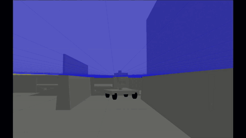

# Mecanum Nav2 Controller

A C++ Nav2 controller plugin for mecanum and omnidirectional robots. I adapted it for the Queen's Knights Robotics Team's autonomous sentry, allowing the robot to follow a path using forward and lateral motion while keeping its heading fixed.

The controller selects a lookahead point, transforms it into the robot's base frame, and produces `linear.x` and `linear.y` velocity commands. It slows near the goal and limits acceleration between control cycles.



*QKRT's full navigation stack in Gazebo. Excerpt from `autonav_showcase.mp4`, 0:40–1:10, played at 2× speed.*

## Build

For Ubuntu 22.04 with ROS 2 Humble and Nav2 installed:

```bash
source /opt/ros/humble/setup.bash
mkdir -p ~/ros2_ws/src
cd ~/ros2_ws/src
git clone https://github.com/danielwp22/mecanum-nav2-controller.git
cd ~/ros2_ws
rosdep install --from-paths src --ignore-src -r -y
colcon build --packages-select omni_pursuit_controller
source install/setup.bash
```

## Use

Merge [config/controller_server.yaml](config/controller_server.yaml) into your robot's Nav2 parameters. The plugin name is:

```yaml
plugin: nav2_omni_pursuit_controller::OmniPursuitController
```

Keep your existing localization, TF, planner, and costmap configuration. The base driver must accept forward and lateral velocity commands; wheel kinematics stay in the base driver.

This version commands zero angular velocity and accepts any final yaw in the example config. It does not perform collision checking or implement Nav2 speed limits; plan clear paths and use appropriate external collision protection.

## Credits

Developed for [QKRT's navigation stack](https://github.com/qkrt-rm/qkrt-nav), starting from the [Nav2 pure pursuit tutorial](https://github.com/ros-navigation/navigation2_tutorials/tree/rolling/nav2_pure_pursuit_controller). Original source credits: Shrijit Singh, Pham Cong Trang, and Mitchell Sayer. This extraction includes later QKRT fixes by Noah Ginzburg and codingpackman.

Source: [QKRT commit `75d6f61`](https://github.com/qkrt-rm/qkrt-nav/tree/75d6f614579d15230e2c81477d17ff23389ddbc6/src/omni_pursuit_controller). The standalone package updates build metadata and plugin registration while preserving the controller logic. BSD-3-Clause; see [LICENSE](LICENSE).
